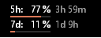
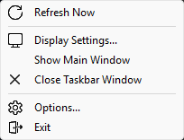
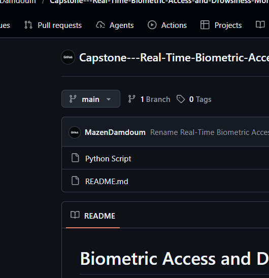
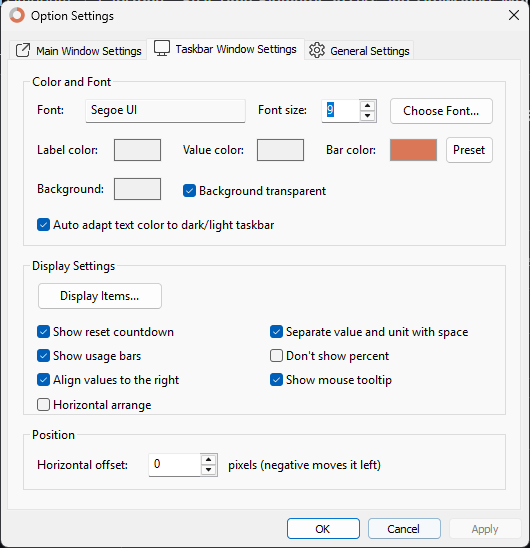
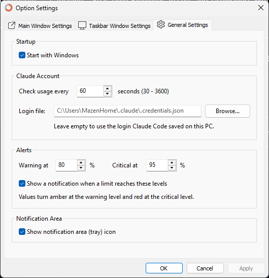

<div align="center">

# Claude Usage Monitor

**Your Claude plan limits, live in the Windows taskbar.**



[Download](../../releases/latest) · [How it works](#how-it-works) · [Build from source](#build-from-source)

</div>

---

A tiny native Windows app (~350 KB, no installer, no runtime) that shows how much of your
Claude **5-hour session** and **weekly** limits you've used, right next to the clock.
These are the same numbers as `/usage` in Claude Code and **Settings → Usage** on claude.ai.

The taskbar integration follows [TrafficMonitor](https://github.com/zhongyang219/TrafficMonitor):
two compact lines that sit beside the system tray and blend into dark or light taskbars.

## Features

- **Live readout in the taskbar.** Session and weekly usage with reset countdowns and optional usage bars.
- **Floating main window.** A compact card you can drag anywhere, pin on top, or make click-through.
- **Warning colors and alerts.** Values turn amber and then red. Optional notifications fire when a limit crosses your thresholds.
- **Every limit your plan has.** Session (5h), Weekly (7d), and Weekly Sonnet / Opus where your plan includes them.
- **Native settings dialogs.** Fonts, colors, layout, which items to show, startup with Windows.
- **Lightweight.** Pure Win32 C++. At most one small HTTPS request every 45–60 s while you work, fewer when idle.

<p align="center"></p>

## Requirements

- Windows 10 or 11 (x64)
- A Claude **Pro or Max** subscription
- [Claude Code](https://claude.com/claude-code), logged in once on this PC (`claude`, then `/login`)

The app reads the login Claude Code already stored, so there is nothing else to sign in to.

## Install

1. Download `ClaudeUsageMonitor.exe` from the [latest release](../../releases/latest).
2. Put it anywhere you like and double-click it.
3. Optional: right-click the readout → **Options... → General Settings → Start with Windows**.

> The exe is not code-signed, so Windows SmartScreen may warn the first time.
> Choose **More info → Run anyway**, or [build it yourself](#build-from-source).

To uninstall, untick *Start with Windows*, exit the app, and delete the exe and
`%APPDATA%\ClaudeUsageMonitor`.

## Usage

The readout appears just left of the system tray. If TrafficMonitor or a similar widget is
already there, it sits beside it instead of on top of it.

| Action | Result |
|---|---|
| Hover | Plan, every limit, exact reset times, last update, next check |
| Right-click | Menu (below) |
| Double-click | Options |
| Run the exe again | Options (it never starts twice) |

**Menu**

| Item | |
|---|---|
| Refresh Now | Fetch usage immediately |
| Display Settings... | Choose which limits to show and their labels |
| Show Main Window | Toggle the floating card |
| Close / Show Taskbar Window | Toggle the taskbar readout |
| Options... | All settings |
| Exit | |

**Options**

| Tab | Settings |
|---|---|
| Main Window | Font, label/value/bar/background colors, opacity, display items, reset countdown, usage bars, tooltip, always on top, mouse penetrate (click-through), lock position, allow off-screen |
| Taskbar Window | Font, colors or automatic white/black for dark/light taskbars, transparent background, display items, reset countdown, usage bars, right-aligned values, horizontal arrangement, horizontal offset |
| General | Start with Windows, live updates, idle check interval, login file, warning/critical levels, notifications, tray icon, phone notifications |

<details>
<summary>Screenshots of the Options dialog</summary>





</details>

## How it works

```
%USERPROFILE%\.claude\.credentials.json      (written by Claude Code)
        │  read-only, every poll
        ▼
UsagePoller (background thread) ──HTTPS──▶ api.anthropic.com/api/oauth/usage
        │  snapshot
        ▼
UI thread, once per second ──▶ taskbar readout · main window · tray icon · alerts
```

- **Data.** The app calls the same usage endpoint Claude Code's `/usage` command uses,
  authenticated with your existing Claude Code OAuth token.
- **Live updates.** While any Claude Code session is working (detected with a file-change
  notification on its session transcripts, which costs nothing while idle), the app checks as often as the endpoint allows.
  When everything is idle it falls back to your interval (60 s by default, up to 1 h). Countdowns
  tick every second, and the app re-checks right after a limit resets.
- **Adaptive pacing.** The endpoint rate-limits bursts, so the gap between requests is learned:
  it starts at a known-safe 60 s, tries 5 s shorter after 10 clean checks (never below 45 s), and on
  HTTP 429 widens the gap by 15 s and avoids the rejected gap for an hour. Repeated 429s back off for minutes. *Refresh Now* also respects the gap. The learned gap,
  last result and next allowed check are cached in `cache.ini`, so a restart shows numbers
  instantly without sending an extra request.
- **Back-off.** Network errors retry after 15 s, 30 s, 1 min and so on, never longer than the
  check interval. A rate-limit response (HTTP 429) waits 2 min, then 4 min and so on, up to
  30 min, and honors `Retry-After`.
- **Taskbar embedding.** The readout is a per-pixel-alpha layered window parented to
  `Shell_TrayWnd` and positioned against `TrayNotifyWnd`, the same technique TrafficMonitor
  uses. It follows the tray as it resizes, survives Explorer restarts, and hides with the taskbar.

> **Note:** the usage endpoint is the one Claude Code uses internally. It is not a documented
> public API, so it could change without notice.

## Phone notifications (optional)

Get an iPhone and Apple Watch notification when your 5-hour or weekly limit resets, see your usage
on your phone, and add Home Screen / Lock Screen widgets. All free, and the Windows app works the same
without it. Two ways to run it:

- **[cloud/](cloud/README.md), recommended for laptops:** runs on your own free Cloudflare account and keeps
  alerting while the laptop is closed. Your Claude login never leaves the PC.
- **[push/](push/README.md):** runs entirely on your PC with Tailscale Funnel. It only works while the PC is on.

**New here? [The guide](docs/GUIDE.md)** shows how everything works, with pictures: the taskbar,
switching, adding and removing accounts, your phone, and your friends' phones.

## Several accounts and friends

With [claude-swap](https://github.com/realiti4/claude-swap) installed, the taskbar shows every saved
Claude account side by side (the one in use in orange). Click one to switch. When the account in
use nears its limit, the app switches by itself, before the limit, so Claude Code carries on with
the same prompt.

With the [cloud relay](cloud/README.md), each friend whose account you use gets their own phone
link. Their phone sees only their account, and they can cap your use of it or ask you to stop;
the Windows app enforces it. See [cloud/FRIENDS.md](cloud/FRIENDS.md) for their side.

## Privacy and security

- Your OAuth token is read from disk only when a request is made, sent only to
  `api.anthropic.com` over HTTPS, and wiped from memory right after.
- The credentials file is **never modified**. The app does not refresh or rotate your login.
  If the token expires because Claude Code hasn't run in a while, the tooltip says so, and
  opening Claude Code once fixes it.
- No telemetry, analytics or other network traffic.
- It runs with normal user privileges (`asInvoker`) and needs no admin rights.

## Configuration

Settings are edited through **Options** and stored in
`%APPDATA%\ClaudeUsageMonitor\settings.ini`. For a portable setup, put a `settings.ini` next
to the exe and that file is used instead.

The login file defaults to `%CLAUDE_CONFIG_DIR%\.credentials.json`, falling back to
`%USERPROFILE%\.claude\.credentials.json`. You can point it elsewhere under
**General → Login file**.

## Build from source

No Visual Studio required:

```powershell
git clone https://github.com/MazenDamdoum/claude-usage-monitor.git
cd claude-usage-monitor
powershell -ExecutionPolicy Bypass -File scripts\build.ps1
```

On first run, the script downloads a pinned, SHA-256-verified portable [Zig](https://ziglang.org)
toolchain into `.tools\`. It then builds with Zig's bundled clang and statically links the C++
runtime.

| Output | |
|---|---|
| `build\ClaudeUsageMonitor.exe` | The app |
| `build\claude-usage.exe` | CLI probe: `claude-usage [--watch [secs]] [--raw]` prints your usage in a console |

With MSVC instead:

```powershell
cmake -B build-msvc -A x64
cmake --build build-msvc --config Release
```

CI builds every push and attaches a zip to tagged releases (`.github/workflows/build.yml`).

## Project structure

```
src/
  main.cpp            App: message loop, menu, tray icon, alerts, autostart
  TaskbarWidget.*     Readout embedded in the taskbar
  MainWindow.*        Floating main window
  OptionsDialog.*     Options property sheet and Display Items dialog
  Canvas.*            Per-pixel-alpha drawing, fonts, Fluent icon glyphs
  UsageView.*         Snapshot → display strings
  UsagePoller.*       Background polling with back-off
  UsageClient.*       Credentials, WinHTTP, response parsing
  Settings.*          settings.ini
  UsageIcon.*         Ring-gauge tray icon
  ResetDetector.*     Confirms limit resets from fresh data (phone notifications)
  PushBridge.*        Hands events to the optional push server, off the UI thread
  AppFiles.*          app.log and other files next to settings.ini
  mini_json.h         Minimal locale-independent JSON reader
  cli.cpp             claude-usage.exe
res/                  Dialogs, manifest (PerMonitorV2 DPI, Win8+ layered child windows), icon
scripts/build.ps1     Zig-based build
scripts/test.ps1      Builds and runs all tests
scripts/make_icon.py  Regenerates res/app.ico
push/                 Optional phone notifications served from your PC
cloud/                Optional phone notifications + widgets on Cloudflare (works with the PC off)
```

## Troubleshooting

| Symptom | Fix |
|---|---|
| Shows `--` | Hover for the reason. Usually Claude Code isn't logged in (`claude` → `/login`) or the token expired (open Claude Code once). |
| "Not found" for the login file | Claude Code stores it in `%USERPROFILE%\.claude\.credentials.json`. If you use `CLAUDE_CONFIG_DIR` or a custom location, set **General → Login file**. |
| Overlaps something in the taskbar | Adjust **Taskbar Window → Horizontal offset**. |
| Numbers seem stale | Hover to see when the next check is due. **Refresh Now** runs as soon as the minimum gap allows. If the endpoint is rate-limiting, the tooltip says so and the app backs off automatically. |
| Want to see what happened | `%APPDATA%\ClaudeUsageMonitor\app.log` has one line per check (kept under 64 KB). |
| Readout missing after an Explorer crash | It reattaches within a second. If not, restart the app. |

`claude-usage.exe --raw` prints the raw API response, which helps when filing a bug.

## Contributing

Issues and pull requests are welcome. Keep changes small and in the style of the surrounding
code (C++17, Win32, no extra dependencies), and confirm `scripts\build.ps1` builds cleanly
before you open a PR.

## License

[MIT](LICENSE). Not affiliated with or endorsed by Anthropic. "Claude" is a trademark of
Anthropic, PBC.
