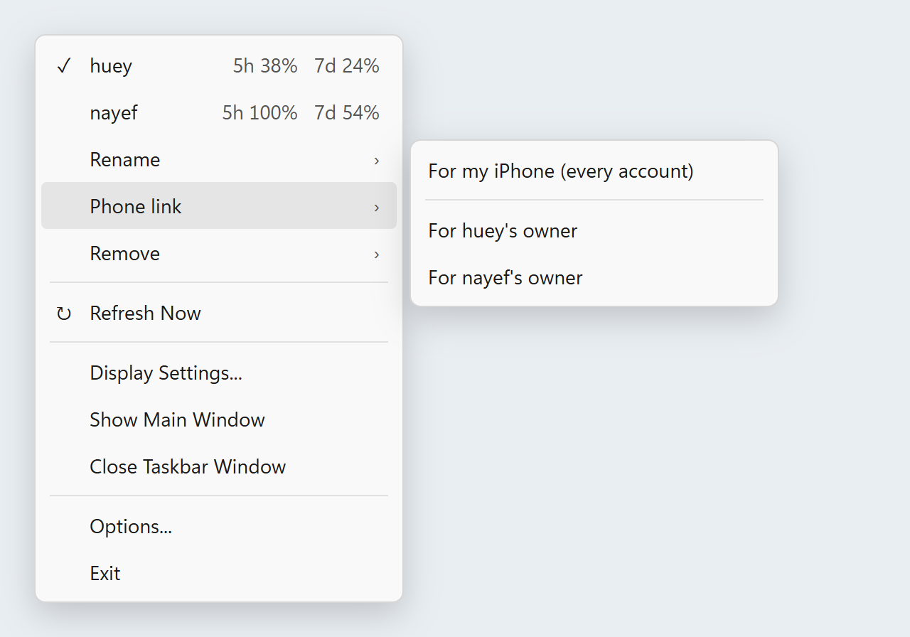
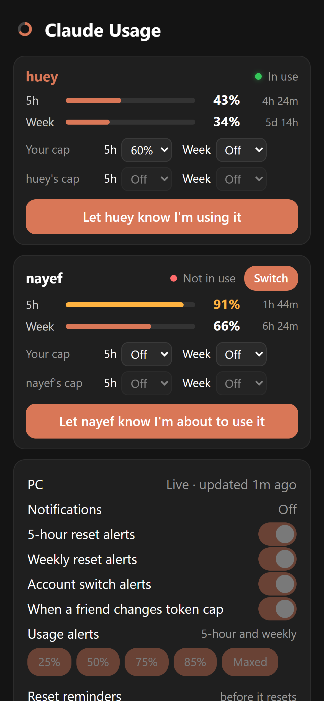
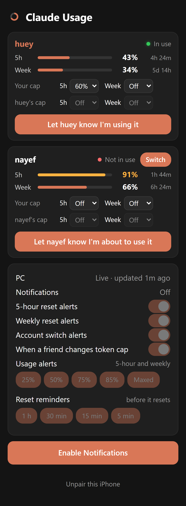
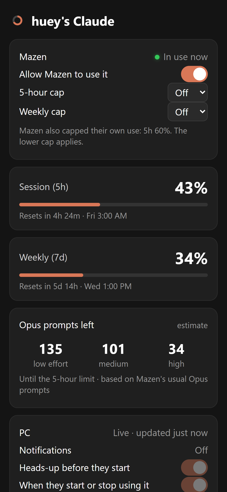
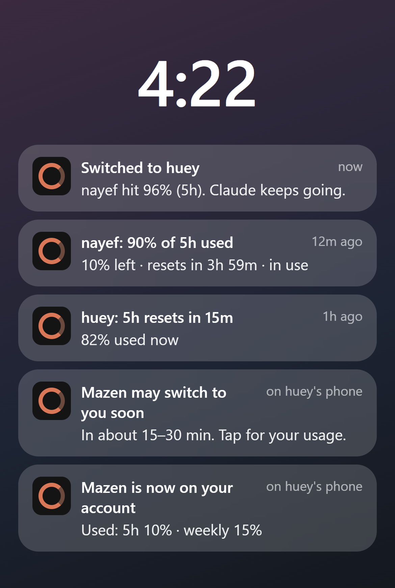

# Claude Usage Monitor: how it works

Claude Usage Monitor shows how much of your Claude plan you've used, right in the Windows taskbar.
If you use more than one Claude account, it shows them all side by side, moves you to the next
one before a limit runs out (so whatever Claude Code is working on keeps going), and keeps you and
the people whose accounts you use informed on your phones.

This guide walks through everything you'll see and do. No technical steps unless you're setting
it up for someone new (the last section).

---

## 1. The taskbar

Each account gets a small column next to the clock, always in the same place:

| | |
|---|---|
| **tok/s** (far left) | Token speed: the tokens Claude is writing per second right now, all your Claude Code sessions together, with Claude's spinner turning faster the more tokens flow. It comes from Claude Code's own logs (not Anthropic's usage checks); while a reply is still being written it is estimated from that session's usual speed, then corrected when the reply lands. Turn it off in right-click → **Display Settings**. |
| **Name** (`huey`, `nayef`) | The account. The one in **orange** is the one Claude Code is using right now. |
| **Top line** | The **5-hour** limit: how much is used, with a bar, and how long until it resets. |
| **Bottom line** | The **weekly** limit, the same way. |

The bars turn yellow and then red as an account gets close to full. Hover over a column to see
whether it's in use or ready to switch to.

## 2. Switching accounts

**By hand:** click an account's column. The switch happens in about a second. As soon as the app
has confirmed that Claude Code is really signed in to the new account, its name turns orange and
glows green for a moment, and your phone is notified. The columns never move. Claude Code carries
on with whatever it was doing, on the new account. You can pick an account even if it's over a
cap (caps steer the automatic switching, not your choice); the app stays there while you chose it.
Only an owner asking you to stop blocks a switch. If Claude Code briefly has its files busy, the
app simply tries again.

**From your phone:** on your phone's page, tap **Switch** on an account's card, then **Confirm**.
Your PC switches within about 10 seconds (it needs to be awake) and you're notified. A request that
the PC doesn't pick up within 2 minutes (it was asleep, say) is dropped, so it never switches later
by surprise.

**Automatically:** when the account in use reaches **95%** of its 5-hour or weekly limit, the app
switches to the account with the most room left, before the limit is hit, so a long-running prompt
doesn't stop. You're notified, and so are the owners of both accounts. If no account has room,
you're told once, and the app switches the moment another account resets.

The app won't switch onto an account whose owner has capped it or asked you to stop (see section 7).

## 3. The right-click menu

Right-click the taskbar readout:

| | |
|---|---|
| **Accounts** (top) | Every account with its 5-hour and weekly usage. ✓ marks the one in use. Click one to switch. |
| **Rename** | Change the name shown on the taskbar (e.g. call an account `huey`). |
| **Phone link** | Make a one-time link to put the phone app on an iPhone: yours, or the owner of an account. The link is copied for you to paste. |
| **Remove** | Take an account off this PC. |
| **Refresh Now** | Check usage straight away. |
| **Display Settings / Options** | Colours, fonts, start with Windows, when to switch automatically (95% by default), and so on. |

## 4. Adding an account

You add an account simply by signing in to it in Claude Code once:

1. In VS Code, open the **Claude Code** panel.
2. Type **`/login`** and press Enter.
3. Your browser opens. Sign in with the account you want to add (your friend signs in, or gives you
   access) and approve it.
4. Within a minute or two it appears on the taskbar by itself, and your PC shows a notification
   saying it was added.
5. Right-click the readout → **Rename** → pick the new account → give it a short name.

Signing in also makes it the account in use. Click another column to switch back whenever you like.
You never need to sign in again after this: the app keeps every account's login and switches
between them for you.

## 5. Removing an account

Right-click the readout → **Remove** → pick the account → **Yes**.

Its saved login is deleted from this PC, the app stops switching to it, and its owner's phone stops
getting updates. You can't remove the account that's in use; switch to another one first. To add
it back later, sign in to it again (section 4).

## 6. Your phone

### Putting it on your iPhone

1. Right-click the readout → **Phone link** → **For my iPhone**. The link is copied.
2. Send it to yourself (Notes, Messages, email) and open it on your iPhone in **Safari**.
3. Tap **Share** → **Add to Home Screen** → **Add**.
4. Open **Claude Usage** from your Home Screen. It signs in by itself.
5. Tap **Enable Notifications** and allow them.

### What you see

Every account is on one page, the one in use first, each in its own card:

- **Green** light and orange name: in use right now. **Red**: not in use.
- **5h** and **Week:** how much is used, with a bar, and how long until it resets.
- **Your cap:** limit how much of that account you'll use, for example after agreeing 40% with its
  owner.
- **huey's cap:** the cap the owner set from their own phone, shown greyed out (only they can change
  it). If both of you set one, the lower one wins.
- **Switch:** move your PC to this account from wherever you are (section 2).
- **Let huey know I'm about to use it:** sends that account's owner a heads-up. Only your phone has
  this button.

### Choosing your notifications

At the bottom you can turn each kind of alert on or off:

- **Usage alerts** at 25%, 50%, 75%, 85% and when a limit is reached (orange = on).
- **Reset reminders** 1 hour, 30, 15 and 5 minutes before a limit resets.
- **Reset alerts**, **account switch alerts**, and **when a friend changes token cap** (caps, stop).

## 7. Friends whose accounts you use

Each friend gets the app on their own iPhone, showing **only their own account**.

### Giving a friend their link

1. Right-click the readout → **Phone link** → **For huey's owner**. The link is copied.
2. Paste it to them in a message. They open it in Safari, tap **Share → Add to Home Screen**, open
   Claude Usage from the Home Screen and tap **Enable Notifications**.

Each link works once, within 24 hours. If it says it was already used or has expired, make a new
one the same way. Tell them not to open it on a computer first.

### What they see and control

- Whether you're using their account right now (**green** = in use, **red** = not).
- Their account's live usage and how many prompts are left on it.
- **Allow Mazen to use it:** turn it off and your PC moves off their account straight away, and
  stays off until they turn it back on. You're notified.
- **5-hour cap / weekly cap:** your PC stops using their account at that percentage.
- Their own choice of notifications: each kind has its own switch (heads-ups, start and stop, your
  cap changes, usage levels, reset reminders and resets).

They never see your other accounts, your conversations or anyone's email address.

## 8. Notifications

| You get | Your friends get (about their own account) |
|---|---|
| When the app switches accounts, and why | A heads-up 15–30 minutes before you start using theirs |
| Usage at 25 / 50 / 75 / 85% and when a limit is reached | When you start and stop using it |
| Reminders before each reset, and when it resets | Usage at 25 / 50 / 75 / 85% and when it's reached |
| When a friend caps their account or asks you to stop | Reminders before each reset, and when it resets |

Tap any notification to open the app on the current usage.

## 9. Common questions

**Does my PC need to be on?** For live usage and switching, yes: they happen on your PC. Reset
alerts and reminders still arrive with the PC off, from the times it last reported.

**I get every notification twice.** There are two Claude Usage icons on that phone. Open the older
one, tap **Unpair this iPhone** at the bottom, and delete it.

**A friend's link says it was already used.** Someone opened it first (often on a computer).
Make a new one: right-click → **Phone link**.

**It didn't switch when I expected.** No other account had room, or its owner capped it or asked
you to stop. You'll have had a notification saying which.

**How do I stop sharing with someone?** They tap **Unpair this iPhone** in their app, or you remove
their account from the PC (section 5).

**Are the "prompts left" numbers exact?** They're an estimate from how you've used Claude Code over
the last two weeks. Use from claude.ai or the Claude phone app isn't counted, so they lean low.

## 10. Setting it up for someone new

For someone who wants their own monitor (one account, or several):

1. Download **ClaudeUsageMonitor.exe** from the project's Releases page, put it anywhere and run it.
   Their usage appears in the taskbar. That's all for one account.
2. **More than one account:** install [claude-swap](https://github.com/realiti4/claude-swap)
   (in a terminal: `pipx install claude-swap`, or `uv tool install claude-swap`), then add accounts as in section 4.
3. **Phone app:** they need their own free Cloudflare account and a one-time setup on their PC
   (`cloud\setup.ps1`, which needs Node.js). [cloud/README.md](../cloud/README.md) walks through it.
   After that, **Phone link** in the menu works for them too.

Friends who only share an account with you need none of this, just the link from section 7.
